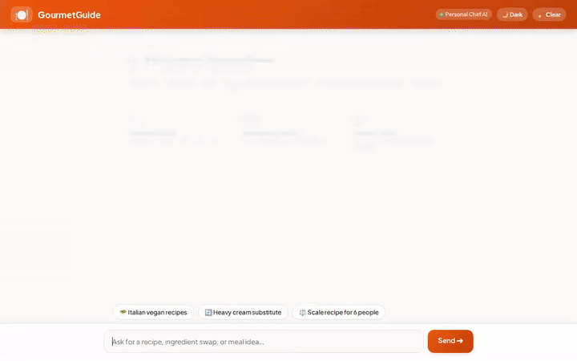

# 🧑‍🍳 GourmetGuide - AI Personal Chef & Recipe Assistant



**GourmetGuide** is an autonomous AI Personal Chef and intelligent recipe assistant built with Google's Agent Development Kit (ADK) and powered by **Gemini 2.5 Flash**. GourmetGuide helps home cooks discover, scale, and visualize delicious meals tailored to their dietary needs and food allergies.

---

## ✨ Features & Capabilities

GourmetGuide provides a rich suite of culinary tools and intelligent features:

- 🥗 **Smart Recipe Search & Lookups**: Searches and retrieves recipe details from Google Cloud Firestore filtered by cuisine style (e.g., Italian, Asian, Mediterranean) and dietary tags (e.g., vegan, gluten-free, keto).
- 🧠 **Cross-Session Long-Term Memory**: Powered by **Vertex AI Memory Bank**, GourmetGuide remembers your dietary preferences, favorite cuisines, and critical food allergies across conversations for tailored safety.
- 🖼️ **AI Dish Photography (Imagen 3)**: Generates high-quality studio food photography for dishes using Google's `imagen-3.0-generate-002` model and serves them via public Google Cloud Storage.
- 🎥 **AI Cooking Video Generation (Gemini Omni)**: Produces food preparation and plating videos using `gemini-omni-flash-preview` in the `global` region, saving artifacts to the ADK Playground and Cloud Storage.
- 🎴 **Adaptive Responsive UI (A2UI)**: Renders native, rich display cards with clean typography, recipe cards, and image previews using the A2UI 0.8 framework.
- 📏 **Portion Scaling Engine**: Automatically recalculates ingredient quantities and portion sizes for custom target serving counts.
- 🧂 **Culinary Substitution Engine**: Suggests substitution ratios for allergies and dietary restrictions (e.g., flax egg, coconut cream, gluten-free flour swaps).
- 🌍 **Global Recipe Discovery**: Integrates with **TheMealDB** REST API to fetch international recipe ideas and video guides in real time.
- 💻 **Sandboxed Code Execution**: Executes Python logic securely within the Agent Engine Code Execution sandbox.

---

## 🛠️ Technology Stack & Architecture

- **AI Framework**: Google Agent Development Kit (ADK) `v1.8.0`
- **Core Model**: Gemini 2.5 Flash (`gemini-2.5-flash`)
- **Memory Service**: Vertex AI Memory Bank Service
- **Database**: Google Cloud Firestore (`recipes` collection)
- **Media & Storage**: Google Cloud Storage (GCS)
- **Media Generation Models**:
  - Image: Imagen 3 (`imagen-3.0-generate-002`)
  - Video: Gemini Omni Flash Preview (`gemini-omni-flash-preview`)
- **External API**: TheMealDB API
- **Frontend**: FastAPI proxy server with an interactive chat web UI and built-in A2UI card renderer

---

## 📋 Planned / Roadmap Capabilities

The following features were outlined in initial design concepts and are planned for future releases:

- 🛒 *Automatic Grocery Cart Integration (Planned, not yet implemented)*
- 📱 *Smart Pantry Scanner via Vision (Planned, not yet implemented)*
- ⏱️ *Multi-Timer Cooking Assistant (Planned, not yet implemented)*

---

## 🚀 Local Setup & Running Instructions

Follow these steps to run GourmetGuide locally on your machine.

### Prerequisites
- Python 3.10+
- Node.js 18+
- Google Cloud SDK (`gcloud` authenticated with a GCP project)
- `agents-cli` installed

### 1. Backend Agent Setup

Clone the repository and set up a Python virtual environment:

```bash
cd gourmet-guide
python3 -m venv .venv
source .venv/bin/activate
pip install -r requirements.txt
```

Start the ADK web development server / playground:

```bash
agents-cli web
```

### 2. Frontend Chat UI Setup

In a separate terminal, navigate to the `frontend/` directory and install dependencies:

```bash
cd frontend
pip install -r requirements.txt
```

Set the required environment variables pointing to your agent:

```bash
export AGENT_DIRECTORY="app"
# Optional: Set AGENT_ENGINE_RESOURCE_NAME if connecting to a deployed Agent Engine resource
```

Start the local FastAPI chat server:

```bash
python main.py
```

Open your browser to the local server address output by FastAPI to interact with GourmetGuide.

---

## 🛡️ License

Licensed under the Apache License, Version 2.0.
